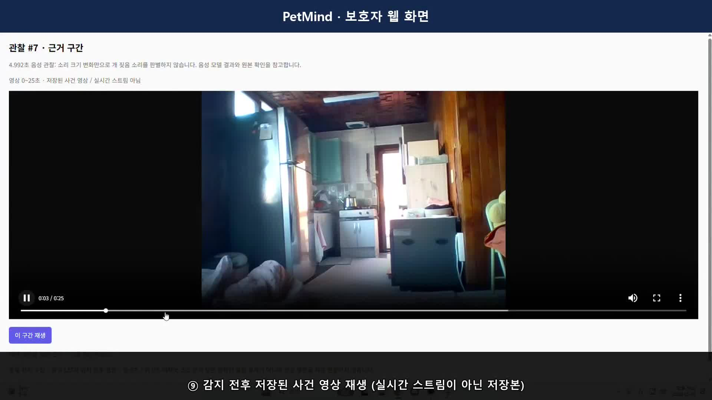
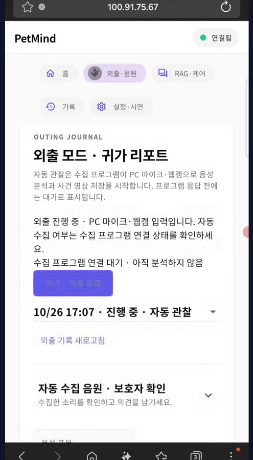
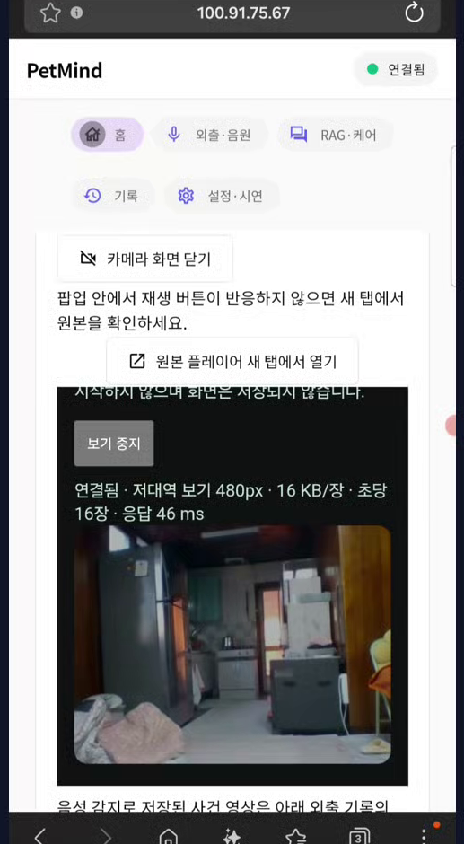
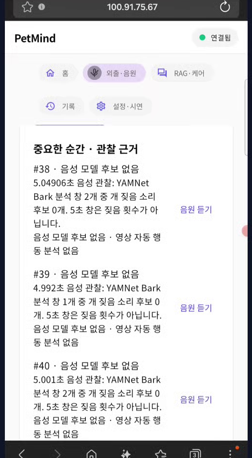

<b>CAPSTONE DESIGN</b>

# PetMind

**반려견의 소리와 과거 기록을 살펴 보호자의 돌봄을 돕는 시스템**

| 유형 | 지도교수 | ESC 팀 | 발표 |
|:---:|:---:|:---:|:---:|
| 창의형 | 우주 | 김재준 · 유민형 · 임성배 | 중간발표 이후 진척 |

[01 비교](#01--한눈에-보는-비교) · [02 블록도](#02--현재-동작-순서) · [03 시연 영상](#03--시연-영상) · [04 진척도](#04--진척도) · [05 다음 계획](#05--다음-계획)

---

## `01`  한눈에 보는 비교

중간발표 이후 진척

| | 10/13 중간발표 | **10/26 현재** |
|---|---|---|
| **짖음 감지 모델** | log-mel LSTM 운영 (외부 평가 F1 42.9%) YAMNet은 비교 실험만 | **YAMNet을 기본 감지기로 채택 (10/22)** **LSTM은 비교용으로만 유지** |
| **실제 입력** | 준비된 파일로만 확인 실제 마이크·카메라 미검증 | **노트북 마이크·웹캠으로 실제 수집** **스피커로 튼 짖음 감지 확인** |
| **보호자 접속** | 이 PC의 브라우저에서만 | **폰·다른 PC에서 접속** **집 밖에서는 Tailscale VPN** |
| **시스템 구조** | 라즈베리파이 수집 + PC 분석 | **PC 하나로 통합** **교수님 블록도 순서로 재구성** |

> **2주간**  커밋 23개 · 파일 124개 변경 · 자동 테스트 Python 156 → 205개, Flutter 21 → 30개 통과

발표 노트

중간발표 이후 네 가지가 크게 바뀌었습니다. 첫째, 비교 실험만 했던 YAMNet을 실제 짖음 감지기로 채택했습니다. 둘째, 준비된 파일이 아니라 노트북 마이크와 웹캠으로 실제 수집합니다. 셋째, 보호자가 폰이나 다른 PC에서, 집 밖에서도 접속할 수 있습니다. 넷째, 라즈베리파이를 빼고 PC 하나로 통합해 교수님께서 그려 주신 순서로 구조를 정리했습니다.

---

## `02`  현재 동작 순서

시스템 블록도 · ①부터 ⑩까지 단계별로 자동 재생됩니다 (한 바퀴 65초)

| 세 칸 구조 | 데이터 경계 | 평가 시작 | 음악 |
|---|---|---|---|
| 왼쪽은 보호자 행동, 가운데는 PC 프로그램, 오른쪽은 외부 장치와 클라우드 | 원본 음성·영상은 PC에만, 클라우드 LLM에는 기록에서 뽑은 근거 문장만 | ⑥ 보호자가 평가를 요청하면 MCP로 같은 반려견의 과거 기록 조회 | ⑨ 승인 후 ⑩ 명령은 이번 발표에서 가상 실행 |

단계를 직접 넘기며 보려면 [`PetMind_동작_순서.html`](PetMind_동작_순서.html)을 내려받아 브라우저로 여세요. 멈춘 그림은 [`assets/block_diagram.png`](assets/block_diagram.png).

발표 노트

외출 모드를 켜면 수집 프로그램이 마이크와 웹캠을 5초 단위로 모으고, PC에서 도는 YAMNet이 짖음 후보를 찾아 SQLite에 기록합니다. 보호자는 폰이나 PC에서 원본을 확인하고 의견을 남깁니다. 평가를 요청하면 로컬 MCP 서버가 같은 반려견의 과거 기록만 꺼내 클라우드 LLM에 전달하고, 서버가 응답의 근거를 검사한 뒤 화면에 보여 줍니다. 원본 음성과 영상은 PC 밖으로 나가지 않습니다. 음악 명령은 이번 발표에서는 가상 실행이고, 실제 재생은 다음 발표에서 보여 드리겠습니다.

---

## `03`  시연 영상

외출 기록부터 폰 원격 확인까지 · 2분 35초

| 1부 · PC 보호자 화면 | 2부 · 폰으로 접속 |
|---|---|
| 외출 모드 · 실시간 카메라 | Tailscale로 같은 화면 접속 |
| RAG 평가 · 사건 영상 재생 | 폰에서 실시간 카메라 |
| Gemini 제안 · MCP 근거 | 귀가 요약 · 원본 재생 |

발표 노트

실제 동작 영상입니다. 1부는 PC 보호자 화면에서 외출 모드를 켜고, 감지된 구간의 원본 소리와 앞뒤 영상을 확인한 뒤, 과거 기록을 근거로 Gemini가 만든 확인 제안을 보는 과정입니다. 2부는 폰에서 Tailscale로 같은 화면에 접속해 실시간 카메라와 귀가 요약을 확인하는 모습입니다. 영상 속 케어 제안 문구는 녹화 시점 기준입니다.

---

## `04`  진척도

### ① 폰으로 확인하는 보호자 화면

<table>
<tr>
<td align="center" width="22%"> <b>외출 진행 중</b></td>
<td align="center" width="22%"> <b>PC 웹캠 실시간 화면</b></td>
<td align="center" width="22%"> <b>중요한 순간 · 관찰 근거</b></td>
<td valign="top">

**집 와이파이** QR 코드 + 접속 키로 바로 접속

**집 밖** Tailscale VPN으로 모바일 데이터에서도 접속, 공개 인터넷에는 열지 않음

**느린 망 대응** 카메라 화면을 망 속도에 맞춰 자동 조절, 데이터 사용량 약 1/8

**인터넷 없을 때** 글꼴을 앱에 넣어 글자가 깨지지 않음

</td>
</tr>
</table>

발표 노트

보호자는 이제 폰으로 외출 기록, 실시간 카메라, 관찰 근거를 확인할 수 있습니다. 집 와이파이에서는 QR 코드와 접속 키로 들어오고, 집 밖에서는 Tailscale VPN을 거쳐 모바일 데이터에서도 접속합니다. 서버를 공개 인터넷에 열지 않는 방식입니다. 모바일 망에서 카메라가 밀리던 문제는 망 속도에 맞춰 화질과 요청 수를 조절해 데이터 사용량을 약 8분의 1로 줄였습니다.

### ② 짖음 감지 검증

<table>
<tr>
<td align="center" width="33%"><h1>40 / 40</h1><b>ESC-50 개 소리 감지</b> 2,000클립 전체 평가</td>
<td align="center" width="33%"><h1>1.4%</h1><b>생활 소음 오탐</b> FSD50K 680클립 · 짖음 40/49 감지</td>
<td align="center" width="33%"><h1>2/2 · 3/4</h1><b>실제 마이크 감지</b> 스피커로 튼 짖음을 내장 마이크로</td>
</tr>
</table>

**생활 소음 종류별 오탐** (판정 기준 0.05 고정)

| 소리 | 오탐 | 소리 | 오탐 |
|---|---:|---|---:|
| 초인종 | 0 / 26 | 노크 | 0 / 60 |
| 전화 | 0 / 60 | 음악 (TV 대용) | 0 / 60 |
| 말소리 | 1 / 80 | 울음 | **4 / 28** |
| 고양이 | **3 / 60** | 알람 | 0 / 40 |

> **수집 안정성**  10분 연속 수집 중 FFmpeg를 2번 강제 종료해도 자동 재시작, 메모리·디스크 증가 없음
>
> **개선 과제**  1초 미만 짧은 짖음, 울음·고양이처럼 음색이 비슷한 소리

공개 음원 평가와 재생음 시험 결과이며 실제 반려견·가정 환경 정확도는 아님

발표 노트

YAMNet을 채택한 근거입니다. 판정 기준을 0.05로 고정하고 ESC-50 전체 2,000개 클립에서 개 소리 40개를 모두 찾았습니다. 초인종, 노크, 전화, 말소리, 울음 같은 생활 소음 680개 클립에서는 오탐이 1.4%였고, 초인종·노크·전화·음악에서는 한 번도 오탐하지 않았습니다. 실제 노트북 마이크로도 스피커로 튼 짖음을 감지했습니다. 다만 1초 미만의 짧은 짖음과 울음·고양이처럼 음색이 비슷한 소리는 개선 과제입니다.

---

## `05`  다음 계획

다음 진척 발표에서 보여 드릴 것

| `구현 완료 · 시연 예정` **지속 짖음 알림 + 음악 실제 재생** | `검증 예정` **실제 강아지로 시험** | `개선 예정` **짖음 감지 보완** |
|---|---|---|
| **알림** 짖음 후보가 30초 이어지면 화면 경고와 폰 푸시 | **감지** 거리·방향·방 소음 속 실제 짖음 | **짧은 짖음** 1초 미만 짖음 놓침 줄이기 |
| **제안** 음악 재생 여부를 묻는 승인 대기 제안 | **알림** 30초 지속 기준이 적절한지 | **오탐** 울음·고양이 같은 비슷한 소리 |
| **재생** 승인하면 PC 스피커로 잔잔한 음악 (최대 60초) | **재생** 볼륨과 승인에서 재생까지 걸리는 시간 | **기록** 재생 전후 짖음 변화 기록 |

> **목표**  감지 → 알림 → 승인 → 실제 음악 재생 → 결과 기록까지, 실제 강아지로 처음부터 끝까지 연속 시연

발표 노트

지속 짖음 알림과 실제 음악 재생은 이미 구현했지만, 감지부터 재생까지 한 흐름으로 보여 드리기 위해 다음 발표에서 함께 시연하겠습니다. 그 전에 실제 강아지로 감지와 알림 기준을 검증하고, 짧은 짖음과 비슷한 소리 오탐을 보완하겠습니다.

