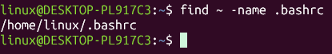
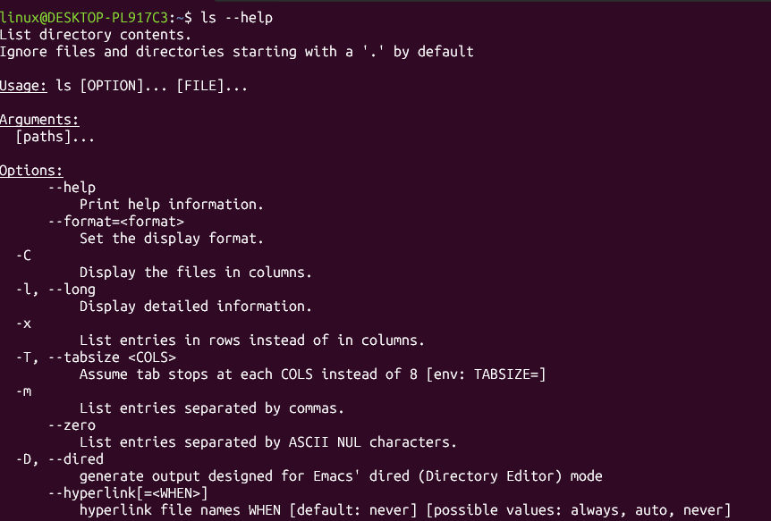
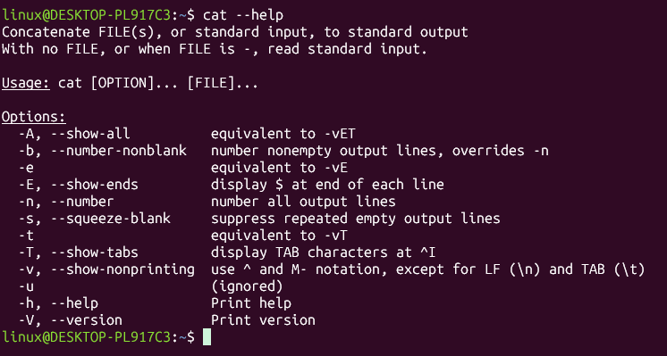
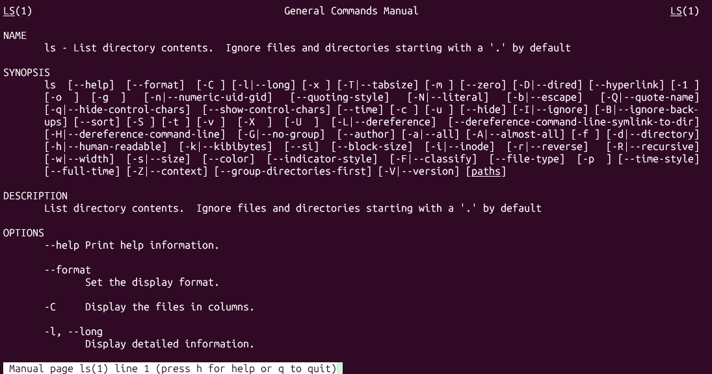
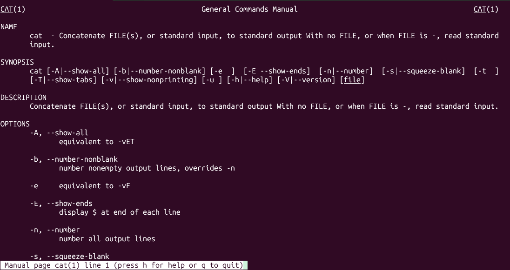

# find 명령어로 .bashrc 파일의 위치를 검색하라.
```bash
$ find ~ -name .bashrc
/home/linux/.bashrc
```
- `find` : 지정한 디렉터리를 기점으로 디렉터리 트리를 내려가면서 검색 조건에 맞는 파일을 찾는 명령어
- `~` : 검색할 디렉터리, 홈 디렉터리(/home/linux)를 기점으로 검색
- `-name .bashrc` : 검색 조건, 파일 이름이 .bashrc인 파일을 찾음
- 액션을 지정하지 않았으므로 기본 액션인 `-print`가 적용되어 찾은 파일의 경로를 출력
- .bashrc는 배시셸의 설정 파일로, .으로 시작하는 숨김파일이지만 find는 숨김파일도 검색함

```bash
$ find / -name .bashrc 2> /dev/null
/etc/skel/.bashrc
/home/linux/.bashrc
```
- 루트 디렉터리(/)를 기점으로 시스템 전체에서 검색
- 권한이 없는 디렉터리는 Permission denied 에러가 출력되므로 `2> /dev/null`로 에러 메시지를 버림
- /etc/skel/.bashrc는 새 사용자를 만들 때 홈 디렉터리에 복사되는 기본 설정 파일



# 다음 2가지 명령어의 차이는 무엇인가?
```bash
$ find . -name '*.txt'
$ find . -name *.txt
```
| 명령어 | 동작 |
| --- | --- |
| `find . -name '*.txt'` | 작은따옴표 안의 *는 셸이 확장하지 않으므로 `*.txt`라는 패턴이 그대로 find에 전달됨, find가 작업 디렉터리와 모든 서브 디렉터리에서 .txt로 끝나는 파일을 모두 검색 |
| `find . -name *.txt` | 셸이 find를 실행하기 전에 `*.txt`를 작업 디렉터리의 파일 이름으로 먼저 경로 확장한 뒤 그 결과를 find에 전달함, 따라서 작업 디렉터리에 있는 .txt 파일의 개수에 따라 결과가 달라짐 |

따옴표가 없을 때 작업 디렉터리의 .txt 파일 개수에 따른 결과 (예: 작업 디렉터리에 a.txt, 서브 디렉터리 sub에 a.txt, b.txt가 있는 경우)

| 작업 디렉터리의 .txt 파일 | 셸이 확장한 명령어 | 결과 |
| --- | --- | --- |
| 0개 | `find . -name *.txt` (확장할 파일이 없어 그대로 전달) | 따옴표를 쓴 것과 같은 결과 |
| 1개 (a.txt) | `find . -name a.txt` | 이름이 a.txt인 파일만 검색되고 sub/b.txt는 검색되지 않음 |
| 2개 이상 (a.txt, c.txt) | `find . -name a.txt c.txt` | -name 뒤에 인자가 2개가 되어 `find: paths must precede expression` 에러 발생 |

- 결론 : find의 검색 조건에 *, ? 같은 메타 문자를 사용할 때는 반드시 작은따옴표(또는 큰따옴표)로 감싸야 셸의 경로 확장 없이 의도한 패턴이 find에 전달됨



# --help 옵션을 사용하여 명령어의 사용법을 출력하는 예제를 만들어보라
```bash
$ ls --help
$ cat --help
```
- `--help` : 대부분의 리눅스 명령어가 제공하는 옵션, 명령어의 간단한 도움말을 화면에 출력
- 출력 내용 : 사용 방법(Usage: ls [OPTION]... [FILE]...), 명령어 개요, 지정할 수 있는 옵션 목록과 의미
- 내용이 길어 화면을 넘어가면 `ls --help | less`처럼 less로 넘겨 한 화면씩 볼 수 있음



# man 명령어로 명령어의 사용법을 출력하는 예제를 만들어보라
```bash
$ man cat
$ man ls
```
- `man <명령어>` : 지정한 명령어의 온라인 매뉴얼을 출력, --help보다 훨씬 자세한 내용(NAME, SYNOPSIS, DESCRIPTION, AUTHOR, SEE ALSO 등)을 담고 있음
- 매뉴얼은 less로 표시되므로 Space는 다음 화면, b는 이전 화면, /문자열은 검색, q는 종료



# cd, ls, cp, rm, ifconfig 명령어의 실행파일이 존재하는 경로를 조사하라.
```bash
$ which -a ls cp rm ifconfig
$ type cd
```
| 명령어 | 실행파일 경로 | 설명 |
| --- | --- | --- |
| cd | 없음 (셸 내장 명령어) | `type cd` 결과 `cd is a shell builtin`, 배시셸 자체에 포함된 명령어라 별도의 실행파일이 없으므로 which로 검색하면 아무것도 출력되지 않음 |
| ls | /usr/bin/ls, /bin/ls | 파일 목록 출력 |
| cp | /usr/bin/cp, /bin/cp | 파일 복사 |
| rm | /usr/bin/rm, /bin/rm | 파일 삭제 |
| ifconfig | /usr/sbin/ifconfig, /sbin/ifconfig | 네트워크 인터페이스 설정 및 확인, 관리자용 명령어라 sbin에 있음, net-tools 패키지에 포함되어 있어 설치되어 있지 않으면 `sudo apt install net-tools`로 설치 |

- `which` : 환경변수 PATH에 저장된 디렉터리를 검색하여 명령어 실행파일의 전체 경로를 출력, `-a` 옵션을 지정하면 같은 이름의 파일을 모두 출력
- `type` : 명령어가 셸 내장 명령어인지, 별칭(alias)인지, 실행파일인지 알려줌
- 최근 우분투는 /bin이 /usr/bin을, /sbin이 /usr/sbin을 가리키는 심볼릭 링크이므로 같은 파일이 두 경로로 검색됨 (`ls -ld /bin`으로 확인 가능)


