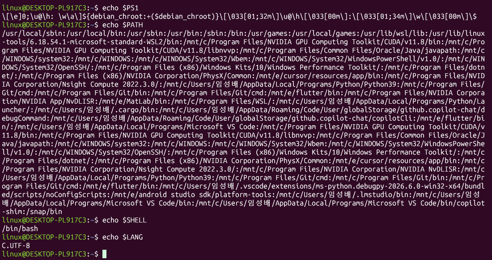
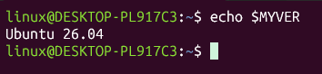

# 실습과제
## 셸변수와 환경변수의 차이점을 설명하라.
| 구분 | 셸변수 | 환경변수 |
| --- | --- | --- |
| 의미 | 셸 내부에서 사용하는 변수, 숫자나 문자열 등 셸의 특성값을 저장 | 셸변수 중 외부 명령어에서도 참조할 수 있도록 설정된 변수 |
| 참조 범위 | 현재 셸 프로세스 안에서만 사용 가능 (내장 명령어만 참조) | 현재 셸 + 셸에서 실행한 외부 명령어(자식 프로세스)에서도 참조 가능 |
| 설정 방법 | `변수명=값` | `export 변수명=값` 또는 셸변수를 만든 뒤 `export 변수명` |
| 목록 확인 | `set` (셸변수와 환경변수 모두 출력) | `printenv` 또는 `env` |
| 예 | PS1 | PATH, LANG, HOME, SHELL |

## 환경변수 PS1, PATH, SHELL, LANG을 출력하고 기능을 설명하라.
| 변수 | 출력 예 | 기능 |
| --- | --- | --- |
| PS1 | `\[\e]0;\u@\h: \w\a\]${debian_chroot:+($debian_chroot)}\u@\h:\w\$` | 프롬프트 문자열을 정의, \u는 사용자 이름, \h는 호스트 이름, \w는 현재 작업 디렉터리를 의미하며 값을 바꾸면 프롬프트 모양이 바뀜 |
| PATH | `/usr/local/sbin:/usr/local/bin:/usr/sbin:/usr/bin:/sbin:/bin:...` | 명령어 실행파일을 찾을 디렉터리 목록, 콜론(:)으로 구분하며 셸은 이 디렉터리들에서 명령어를 찾음 |
| SHELL | `/bin/bash` | 현재 사용자의 로그인 셸 실행파일 경로 |
| LANG | `C.UTF-8` 또는 `ko_KR.UTF-8` | 로케일(언어_지역.문자인코딩) 설정, 명령어의 메시지 언어, 날짜 표시 방식 등이 이 값에 따라 바뀜 |



# 셸이 명령어 파일의 위치를 어떻게 찾는지 설명하라.
1. 명령어를 입력하면 셸은 먼저 그 명령어가 alias(별칭)인지, 셸 내장 명령어(cd, pwd, set 등)인지 확인하고, 해당하면 셸 안에서 바로 실행함
2. 외부 명령어이면 환경변수 PATH에 콜론(:)으로 구분되어 저장된 디렉터리를 앞에서부터 차례대로 검색함
3. 처음 발견된 실행파일을 실행하고, 모든 디렉터리에서 찾지 못하면 `command not found` 에러를 출력함
4. 명령어를 /bin/ls처럼 절대경로나 ./myprog처럼 경로를 포함하여 입력하면 PATH를 검색하지 않고 그 경로의 파일을 바로 실행함
5. 보안 때문에 현재 작업 디렉터리는 PATH에 포함되어 있지 않으므로, 현재 디렉터리의 프로그램은 ./를 붙여 실행해야 함

# 셸스크립트를 설명하라.
- 여러 개의 명령어를 텍스트 파일에 작성해 두고 한 번에 실행할 수 있도록 만든 파일
- 셸이 파일에 적힌 명령어를 위에서부터 한 줄씩 읽어서 실행함
- 반복되는 작업을 자동화할 때 사용하며, 변수, 조건문(if), 반복문(for, while) 등도 사용 가능
- .bashrc, .profile, /etc/profile도 셸이 실행될 때 자동으로 실행되는 셸스크립트임
- 보통 확장자는 .sh를 사용하고, 첫 줄에 `#!/bin/bash`(셔뱅)를 써서 이 파일을 실행할 셸을 지정함

# 셸스크립트의 실행방법 3가지를 조사하라.
| 방법 | 명령어 | 설명 |
| --- | --- | --- |
| 1. bash 명령어의 인자로 실행 | `$ bash hello.sh` | 새로운 bash 프로세스(자식 셸)를 실행하여 스크립트를 읽어 실행, 실행 권한이 없어도 됨 |
| 2. 실행 권한을 주고 경로로 실행 | `$ chmod +x hello.sh`<br>`$ ./hello.sh` | 파일에 실행 권한을 부여한 뒤 경로를 지정하여 실행, 첫 줄의 #!/bin/bash로 지정한 셸이 자식 프로세스로 실행됨, 현재 디렉터리는 PATH에 없으므로 ./를 붙여야 함 |
| 3. source 명령어로 실행 | `$ source hello.sh`<br>`$ . hello.sh` | 새 프로세스를 만들지 않고 **현재 셸**에서 스크립트를 실행, 스크립트에서 설정한 변수가 현재 셸에 그대로 남으므로 .bashrc 수정 내용을 반영할 때 사용 |

# .bashrc 파일에 환경변수 MYVER을 선언하고 값을 ubuntu 26.04로 설정하는 코드를 추가하고 .bashrc 파일을 다시 실행(source)하라. 그리고 환경변수 MYVER의 값이 잘 설정되었는지 명령어(echo)로 확인하라
## 실행 명령어
```bash
$ cp ~/.bashrc ~/.bashrc.org
$ vi ~/.bashrc
$ source ~/.bashrc
$ echo $MYVER
ubuntu 26.04
$ printenv MYVER
ubuntu 26.04
```
| 명령어 | 설명 |
| --- | --- |
| `cp ~/.bashrc ~/.bashrc.org` | 수정하기 전에 .bashrc를 백업, 잘못 수정해도 복원 가능 |
| `vi ~/.bashrc` | vi 에디터로 .bashrc를 열고 `G`로 파일 마지막으로 이동, `o`로 아래에 새 줄을 열어 코드 추가 후 `ESC` → `:wq`로 저장 및 종료 |
| `source ~/.bashrc` | 셸을 종료하지 않고 현재 셸에서 .bashrc를 다시 실행하여 수정 내용을 반영 |
| `echo $MYVER` | 환경변수 MYVER의 값 출력 |
| `printenv MYVER` | 환경변수 목록에 MYVER가 있는지 확인, export했으므로 출력됨 |



# 환경변수에 경로를 추가할 때 $ PATH='$PATH:~/bin' 처럼 작성하면 어떻게 되는지 설명하라.
- 작은따옴표 안의 모든 특수 기호는 무시되므로 $PATH가 기존 PATH 값으로 치환되지 않음
- 따라서 PATH에 `$PATH:~/bin`이라는 글자 그대로의 문자열이 저장되어 기존 경로(/usr/bin, /bin 등)가 모두 사라짐
- 셸은 `$PATH`와 `~/bin`이라는 이름의 디렉터리에서만 명령어를 찾게 되므로, ls, cat 같은 외부 명령어를 찾지 못해 `command not found` 에러가 발생함
- cd, echo 같은 내장 명령어는 PATH와 관계없이 실행됨
- 올바른 방법은 큰따옴표를 사용하여 `PATH="$PATH:~/bin"`으로 작성하는 것, 큰따옴표 안에서는 변수 치환이 적용되어 기존 PATH 뒤에 ~/bin이 추가됨
- 잘못 설정했을 때는 터미널을 닫고 다시 열면 원래 PATH로 복구됨 (PATH 변경은 현재 셸에만 적용되었기 때문)
