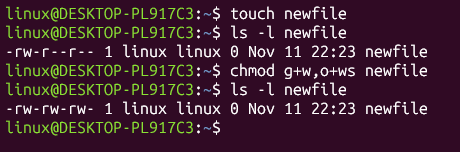

# 실습과제 1
## ls -l 명령어의 출력 결과의 모든 요소를 설명하라.
```bash
$ ls -l /bin/cat
-rwxr-xr-x 1 root root 35280 Feb  8  2022 /bin/cat
```
| 번호 | 출력 | 의미 | 설명 |
| --- | --- | --- | --- |
| 1 | `-` | 파일 타입 | -는 일반 파일, d는 디렉터리, l은 심볼릭 링크 |
| 2 | `rwxr-xr-x` | 퍼미션(파일 모드) | 3글자씩 소유자(user) rwx, 소유 그룹(group) r-x, 다른 사용자(other) r-x의 권한, r은 읽기, w는 쓰기, x는 실행, -는 권한 없음 |
| 3 | `1` | 하드링크 수 | 이 파일을 가리키는 하드링크의 개수 |
| 4 | `root` | 소유자 | 파일의 소유자는 root(슈퍼 사용자) |
| 5 | `root` | 소유 그룹 | 파일을 소유한 그룹은 root 그룹 |
| 6 | `35280` | 파일 크기 | 파일의 크기, 단위는 바이트(byte) |
| 7 | `Feb  8  2022` | 최종 수정 시각 | 파일이 마지막으로 수정된 날짜, 올해가 아닌 경우 시각 대신 연도가 표시됨 |
| 8 | `/bin/cat` | 파일 이름 | 파일의 경로와 이름 |

## 기호모드를 이용하여 newfile의 퍼미션을 다음처럼 수정하라.


| 명령어 | 설명 |
| --- | --- |
| touch | 빈 파일 생성 |
| ls -l <파일> | 파일의 퍼미션 확인 |
| chmod | 퍼미션 변경 |
| g+w | 그룹에 쓰기 권한 추가 |
| o+wx | 다른 사용자에게 쓰기와 실행 권한 추가 |

# 실습과제 2
## 수치모드를 이용하여 newfile1의 퍼미션을 아래처럼 수정하라.


| 명령어 | 설명 |
| --- | --- |
| touch | 빈 파일 생성 |
| ls -l <파일> | 파일의 퍼미션 확인 |
| chmod | 퍼미션 변경 |
| 667 | 수치로 퍼미션 변경 |

| 대상 | 퍼미션 | 2진수 | 계산 | 숫자 |
| --- | --- | --- | --- | --- |
| 소유자(user) | rw- | 110 | 4 + 2 + 0 | 6 |
| 소유 그룹(group) | rw- | 110 | 4 + 2 + 0 | 6 |
| 다른 사용자(other) | rwx | 111 | 4 + 2 + 1 | 7 |

# 실습과제 3
## 리눅스에서 관리자 권한이 필요한 경우에 대하여 조사하라.
| 경우 | 예 |
| --- | --- |
| 소프트웨어 설치, 업데이트, 삭제 | `sudo apt update`, `sudo apt install net-tools`, `sudo apt remove` |
| 시스템 설정 파일 수정 | /etc 아래의 파일 수정 (/etc/profile, /etc/hosts, /etc/fstab 등) |
| 사용자 및 그룹 관리 | 사용자 추가/삭제 `sudo adduser`, `sudo deluser`, 다른 사용자의 암호 변경, 그룹에 사용자 추가 `sudo usermod -aG` |
| 보안 정보가 담긴 파일 열람 | 사용자 암호 정보가 담긴 `/etc/shadow` 읽기 |
| 다른 사용자 소유 파일의 권한/소유자 변경 | `sudo chown`, `sudo chmod`로 root나 다른 사용자 소유 파일 변경 |
| 시스템 디렉터리에 파일 생성/삭제 | /usr/bin, /usr/local/bin, /opt 등에 프로그램 복사 |
| 시스템 종료 및 재부팅 | `sudo shutdown`, `sudo reboot` |
| 서비스(데몬) 관리 | `sudo systemctl start/stop/restart` 로 서비스 시작, 중지 |
| 네트워크 설정 변경 | IP 주소 설정, 방화벽 설정 `sudo ufw` |
| 디스크 및 장치 관리 | 디스크 마운트 `sudo mount`, 파티션 설정 |
| 다른 사용자의 프로세스 종료 | `sudo kill` |

## 파일 퍼미션과 디렉터리 퍼미션의 의미의 차이점을 비교 설명하라.
| 퍼미션 | 파일 | 디렉터리 |
| --- | --- | --- |
| r (읽기) | 파일의 내용을 읽을 수 있음 (cat, less) | 디렉터리 안의 파일 목록을 볼 수 있음 (ls) |
| w (쓰기) | 파일의 내용을 수정할 수 있음 | 디렉터리 안에 파일을 생성, 삭제, 이름 변경할 수 있음 |
| x (실행) | 파일을 프로그램으로 실행할 수 있음 | cd로 디렉터리에 들어가고, 디렉터리 안의 파일에 접근할 수 있음 |

- 파일의 생성과 삭제는 파일의 퍼미션이 아니라 **그 파일이 들어 있는 디렉터리의 w 퍼미션**으로 결정됨 → 파일 퍼미션이 r--r--r--인 읽기 전용 파일도 디렉터리에 w 권한이 있으면 rm으로 삭제 가능
- 디렉터리에 r만 있고 x가 없으면 파일 이름 목록은 보이지만 cd로 들어가거나 파일 내용을 읽을 수 없음
- 디렉터리에 x만 있고 r이 없으면 ls로 목록은 볼 수 없지만, 파일 이름을 정확히 알면 접근 가능
- 다른 사용자에게 공개할 디렉터리는 보통 rwxr-xr-x(755), 공개할 일반 파일은 rw-r--r--(644)로 설정

## su 명령어와 sudo 명령어의 차이를 설명하라.
| 구분 | su | sudo |
| --- | --- | --- |
| 의미 | substitute user, 다른 사용자(기본은 root)로 **전환** | superuser do, 지정한 **명령어 하나만** 관리자 권한으로 실행 |
| 사용법 | `su` 또는 `su -` | `sudo <명령어>` (예: `sudo cat /etc/shadow`) |
| 입력하는 암호 | 전환할 사용자(슈퍼 사용자, root)의 암호 | 현재 로그인한 사용자 자신의 암호 |
| 권한 유지 범위 | exit를 입력하기 전까지 계속 슈퍼 사용자로 유지, 프롬프트가 $에서 #으로 바뀜 | 명령어 실행이 끝나면 바로 일반 사용자로 돌아옴 |
| 사용 조건 | root 암호를 알아야 함 (우분투는 root 암호가 설정되어 있지 않아 `sudo passwd root`로 먼저 설정해야 사용 가능) | sudo 그룹에 소속되어 있어야 함, 아니면 'sudoers 파일에 없습니다' 에러 |
| 환경 | `su`는 일반 사용자의 환경 변수와 작업 디렉터리를 유지, `su -`는 슈퍼 사용자의 환경으로 초기화 | 현재 사용자의 환경에서 명령어만 관리자 권한으로 실행 |
| 안전성 | 슈퍼 사용자로 오래 작업하면 작은 실수로 시스템을 손상시킬 위험이 큼 | 꼭 필요한 명령어에만 관리자 권한을 사용하므로 더 안전함, 사용 기록도 남음 |
