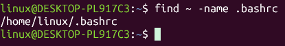
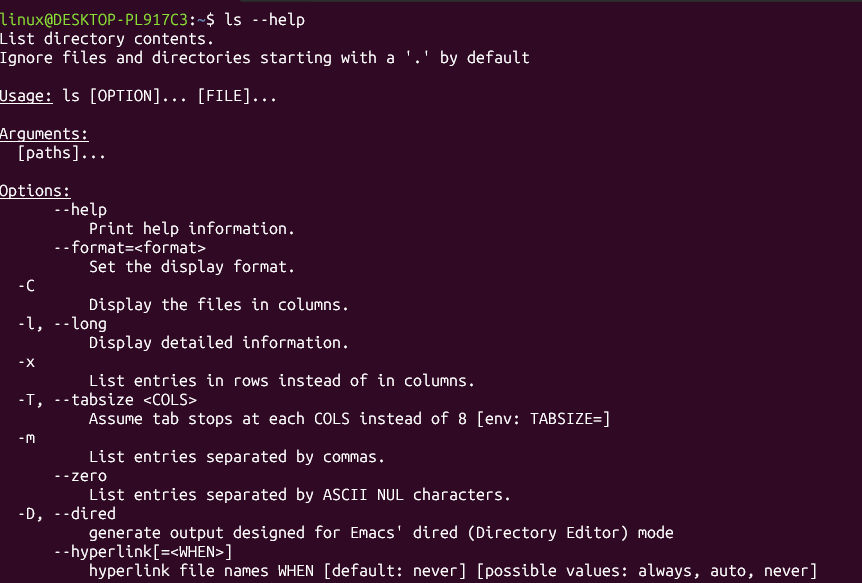
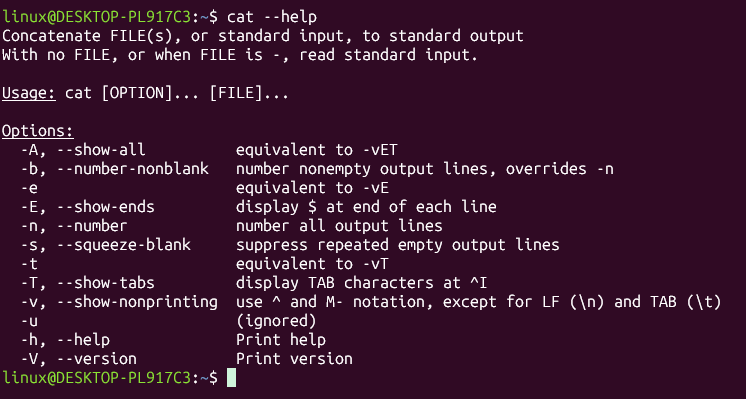
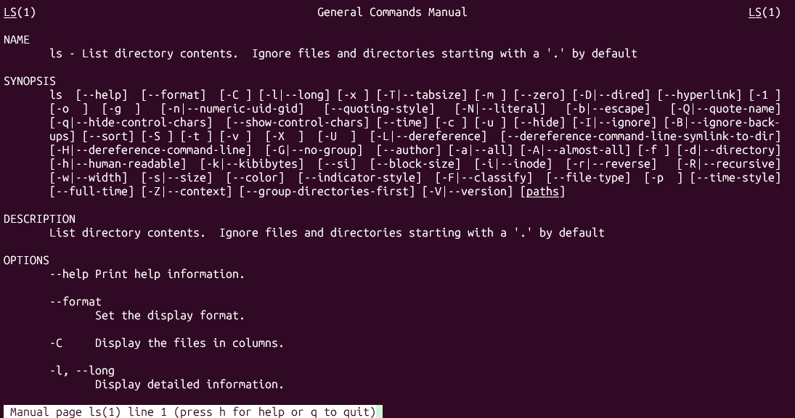
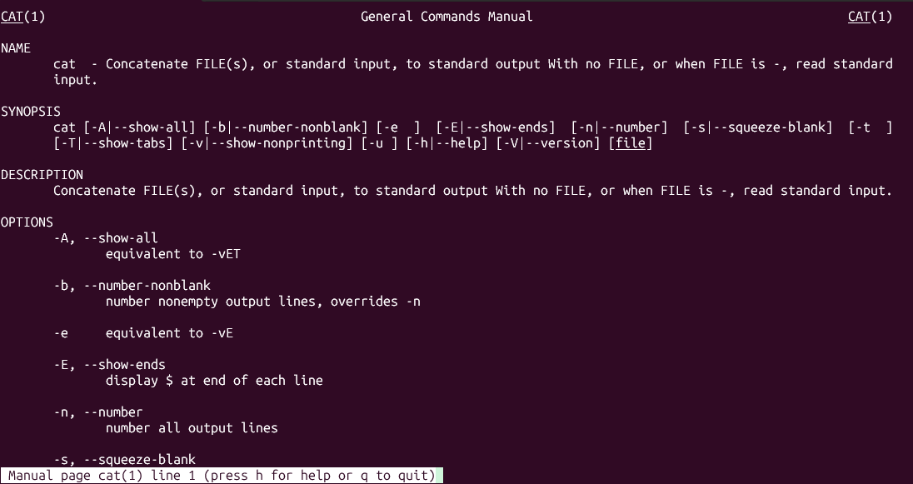

# find 명령어로 .bashrc 파일의 위치를 검색하라.



# 다음 2가지 명령어의 차이는 무엇인가?
```bash
$ find . -name '*.txt'
$ find . -name *.txt
```
| 명령어 | 동작 |
| --- | --- |
| `find . -name '*.txt'` | 작은따옴표 안의 *는 셸이 확장하지 않으므로 `*.txt`라는 패턴이 그대로 find에 전달됨, find가 작업 디렉터리와 모든 서브 디렉터리에서 .txt로 끝나는 파일을 모두 검색 |
| `find . -name *.txt` | 셸이 find를 실행하기 전에 `*.txt`를 작업 디렉터리의 파일 이름으로 먼저 경로 확장한 뒤 그 결과를 find에 전달함, 따라서 작업 디렉터리에 있는 .txt 파일의 개수에 따라 결과가 달라짐 |

# --help 옵션을 사용하여 명령어의 사용법을 출력하는 예제를 만들어보라
```bash
$ ls --help
$ cat --help




# man 명령어로 명령어의 사용법을 출력하는 예제를 만들어보라
```bash
$ man cat
$ man ls




# cd, ls, cp, rm, ifconfig 명령어의 실행파일이 존재하는 경로를 조사하라.
| 명령어 | 실행파일 경로 | 설명 |
| --- | --- | --- |
| cd | 없음 (셸 내장 명령어) | `type cd` 결과 `cd is a shell builtin`, 배시셸 자체에 포함된 명령어라 별도의 실행파일이 없으므로 which로 검색하면 아무것도 출력되지 않음 |
| ls | /usr/bin/ls, /bin/ls | 파일 목록 출력 |
| cp | /usr/bin/cp, /bin/cp | 파일 복사 |
| rm | /usr/bin/rm, /bin/rm | 파일 삭제 |
| ifconfig | /usr/sbin/ifconfig, /sbin/ifconfig | 네트워크 인터페이스 설정 및 확인, 관리자용 명령어라 sbin에 있음, net-tools 패키지에 포함되어 있어 설치되어 있지 않으면 `sudo apt install net-tools`로 설치 |


